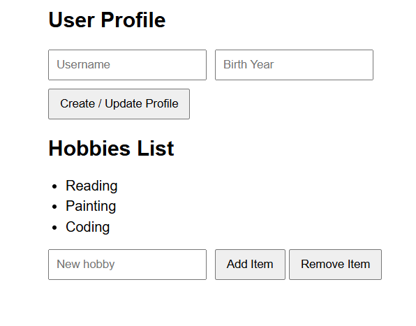
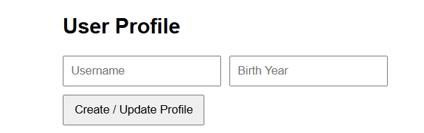
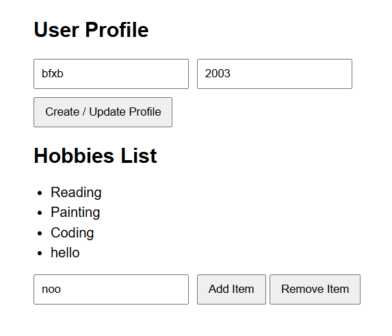
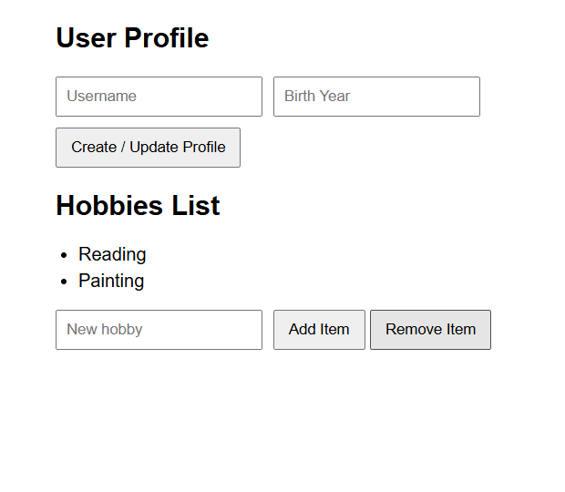

Assignment 5
Aruzhan Abdrakhmanova IT-2501 Site: https://arabdrakh.github.io/front5/

Part 1: Profile Object, Data Types & Arithmetic

Task 1. The Personal Info Object
Created a const object named userProfile storing various data types including string (name), number (birthYear), boolean (isDeveloper), and an array (hobbies).

Task 2. Arithmetic Calculations
Calculated dynamic current age using arithmetic operations (current year minus birthYear), as well as age in months and total hobbies count. Displayed values in the console.

Part 2: Form Input & Event Responses

Task 3. HTML Form Setup
Created an HTML form with input fields for Username and Birth Year, and a "Create / Update Profile" submit button.

Task 4. Event Listener
Added a submit event listener to capture input values and update the userProfile object without page reload.

Part 3: DOM List Manipulation

Task 5. Creating & Removing Elements
Created an unordered list representing hobbies. Added an input field with an "Add Item" button to create and append new li items, and a "Remove Item" button to delete the last item from the list.

Summary
In this assignment, I practiced JavaScript fundamentals including working with objects, data types, arithmetic operations, and DOM manipulation. I implemented event listeners for form submission to update object values and created interactive buttons to dynamically add and remove DOM list elements.
